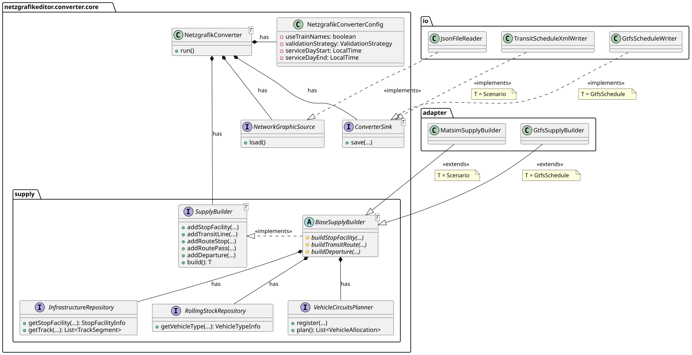

# Netzgrafik-Editor Converter

Converter to expand network graphics from
the [Netzgrafik-Editor](https://github.com/SchweizerischeBundesbahnen/netzgrafik-editor-frontend) into timetables for
the entire service day in different formats, as for example GTFS static or MATSim transit schedules.

## Usage

### Command line

Run the command line tool to convert a network graphic to either a GTFS or MATSim timetable:

```text
Usage: convert [-htV] [-b=<serviceDayBoundary>] [-d=<depotLabel>]
               [-e=<serviceDayEnd>] [-f=<outputFormat>] [-i=<stopFacilityCsv>]
               [-r=<rollingStockCsv>] [-s=<serviceDayStart>]
               [-v=<validationStrategy>] <networkGraphicFile> <outputDirectory>
               
Converts network graphics into timetables in various formats.
      <networkGraphicFile>   The network graphic file to convert.
      <outputDirectory>      The output directory for the converted timetable.
  -b, --service-day-boundary=<serviceDayBoundary>
                             Handling of trips at the service day boundaries
                               (FULL, CLIP, DEPOT).
  -d, --depot-label=<depotLabel>
                             Node label which marks the depots in the network
                               graphic.
  -e, --service-day-end=<serviceDayEnd>
                             Service day end time (HH:mm).
  -f, --format=<outputFormat>
                             Output format (GTFS or MATSim).
  -h, --help                 Show this help message and exit.
  -i, --stop-facility-csv=<stopFacilityCsv>
                             File which contains the coordinates of the stop
                               facilities.
  -r, --rolling-stock-csv=<rollingStockCsv>
                             File which contains the vehicle types to be mapped
                               to network graphic categories.
  -s, --service-day-start=<serviceDayStart>
                             Service day start time (HH:mm).
  -t, --train-names          Use train names as route or line IDs (true/false).
  -v, --validation=<validationStrategy>
                             Validation strategy (SKIP_VALIDATION,
                               WARN_ON_ISSUES, FAIL_ON_ISSUES,
                               REPLACE_WHITESPACE, REMOVE_SPECIAL_CHARACTERS).
  -V, --version              Print version information and exit.
```

Since the Netzgrafik-Editor does not provide information about the coordinates of nodes or rolling stock (vehicle types)
serving a category, this information can optionally be provided through CSV files.

Example:

```sh
# configure paths
NETWORK_GRAPHIC_FILE=../test/src/main/resources/ng/scenarios/realistic.json
OUTPUT_DIRECTORY=../integration-test/output/cmd

# output format: GTFS or MATSIM 
OUTPUT_FORMAT=GTFS

# optional CSV repositories
STOP_FACILITY_INFO_FILE=../test/src/main/resources/ng/scenarios/realistic-stop-facility-info.csv
ROLLING_STOCK_INFO_FILE=../test/src/main/resources/ng/scenarios/realistic-rolling-stock-info.csv

# run the Spring command line runner app to convert to GTFS / MATSim format
ARGS="$NETWORK_GRAPHIC_FILE $OUTPUT_DIRECTORY -f $OUTPUT_FORMAT -i $STOP_FACILITY_INFO_FILE -r $ROLLING_STOCK_INFO_FILE"
./mvnw spring-boot:run -pl app -Dspring-boot.run.arguments=$ARGS
```

### Service day boundary

The trainruns repeat with their frequency from their times in the Netzgrafik-Editor, independent of the service day
start. The service day boundary defines how trips at the start and end of the service day are handled:

| Boundary         | Trips                                                                             |
|------------------|-----------------------------------------------------------------------------------|
| `FULL` (default) | Run their full route if they depart from their first stop within the service day. |
| `CLIP`           | Are clipped to the stops served within the service day.                           |
| `DEPOT`          | Like `CLIP`, but start and end at depots only.                                    |

Depots are the nodes labelled `Depot` in the Netzgrafik-Editor (`--depot-label`) where a line stops; line termini always
count as depots.
See [Service Day Boundary](docs/service-day-boundary/service-day-boundary.md) for the exact rules, the handling of lines
without depot by the validation strategy, and time-distance diagrams.

### Converter in Java

In most cases, the repositories for infrastructure, rolling stock, and vehicle circuits used by the supply builder will
be custom. To configure the converter with these custom repositories, inject them into the supply builder of the
selected timetable output format (refer to the Design section for details) and run the conversion:

```java

public class Example {

    public static final Path NETWORK_GRAPHIC_FILE = Path.of("path/to/networkGraphic.json");
    public static final Path OUTPUT_DIRECTORY = Path.of("path/to/outputDirectory");
    public static final NetworkGraphicConverterConfig CONFIG = NetworkGraphicConverterConfig.builder().build();

    static void main(String[] args) throws IOException {

        // define network graphic source
        NetworkGraphicSource source = new JsonFileReader(NETWORK_GRAPHIC_FILE);

        // instantiate custom implementations of the repositories
        RollingStockRepository customRollingStockRepository = new CustomRollingStockRepository();
        InfrastructureRepository customInfrastructureRepository = new CustomInfrastructureRepository();
        VehicleCircuitsPlanner customVehicleCircuitsPlanner = new CustomVehicleCircuitsPlanner(
                customRollingStockRepository);

        // convert to GTFS
        setupGtfsConverter(customInfrastructureRepository, customRollingStockRepository, customVehicleCircuitsPlanner,
                source).run();

        // convert to MATSim
        setupMatsimConverter(customInfrastructureRepository, customRollingStockRepository, customVehicleCircuitsPlanner,
                source).run();
    }

    private static NetworkGraphicConverter<Scenario> setupMatsimConverter(
            InfrastructureRepository customInfrastructureRepository, RollingStockRepository customRollingStockRepository,
            VehicleCircuitsPlanner customVehicleCircuitsPlanner, NetworkGraphicSource source) {
        SupplyBuilder<Scenario> builder = new MatsimSupplyBuilder(customInfrastructureRepository,
                customRollingStockRepository, customVehicleCircuitsPlanner);
        ConverterSink<Scenario> sink = new TransitScheduleXmlWriter(Example.OUTPUT_DIRECTORY, "");

        return new NetworkGraphicConverter<>(CONFIG, source, builder, sink);
    }

    private static NetworkGraphicConverter<GtfsSchedule> setupGtfsConverter(
            InfrastructureRepository customInfrastructureRepository, RollingStockRepository customRollingStockRepository,
            VehicleCircuitsPlanner customVehicleCircuitsPlanner, NetworkGraphicSource source) {
        SupplyBuilder<GtfsSchedule> builder = new GtfsSupplyBuilder(customInfrastructureRepository,
                customRollingStockRepository, customVehicleCircuitsPlanner);
        ConverterSink<GtfsSchedule> sink = new GtfsScheduleWriter(Example.OUTPUT_DIRECTORY, true);

        return new NetworkGraphicConverter<>(CONFIG, source, builder, sink);
    }

}
```

## Design

The Maven project is structured into three modules: `app`, `lib` and `test`.

### Application

A command-line application based on Spring Boot's `CommandLineRunner`, which serves as the entry point for interacting
with the converter. The application module isolates the Spring Boot dependency.

### Library

The core functionality of the project is encapsulated in the library module, which provides the logic for reading,
converting, and writing network graphic data. The library has a modular design (DI):

- **converter**: Reads a network graphic from a source, converts it, and writes to a sink.
    - **core**: Converter logic and configuration.
        - **model**: DTOs to read network graphic data from JSON.
        - **supply**: A generic supply builder interface. Defines infrastructure and rolling stock repositories, as well
          as vehicle circuits planner interfaces used in the builder.
        - **validation**: Network graphic ID validator and sanitizer.
    - **adapter**: Format-specific transit schedule builder, implementing the supply builder interface.
    - **io**: Provides implementations for network graphic sources and converter output sinks.
    - **utils**: Utilities used across multiple domains.

The class diagram outlines core classes and their relationships:



### Testing

Enables access to test case files and provides a JUnit Jupiter Extension for easy integration test directory path
handling. Both the library and application modules depend on this module in the test scope.

## Contributing

This repository includes [Contribution Guidelines](CONTRIBUTING.md) that outline how to contribute to the project,
including how to submit bug reports, feature requests, and pull requests.
The [Coding Standards](CODING_STANDARDS.md) outline best practices and rules to follow when coding.
Details on releasing are described in the [Release](RELEASE.md) document.

## License

This project is licensed under GNU [GPL-3.0](LICENSE).

© 2024 Swiss Federal Railways SBB AG.
