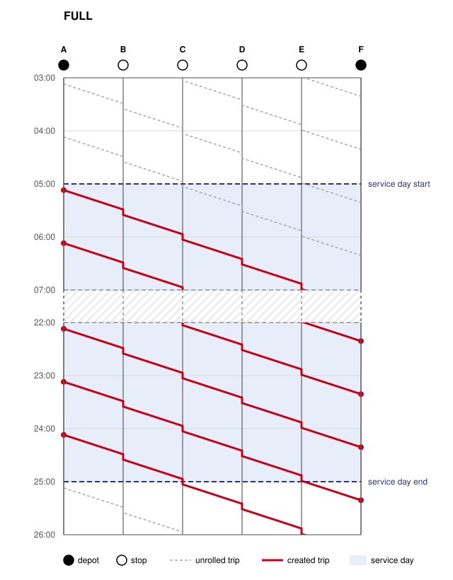
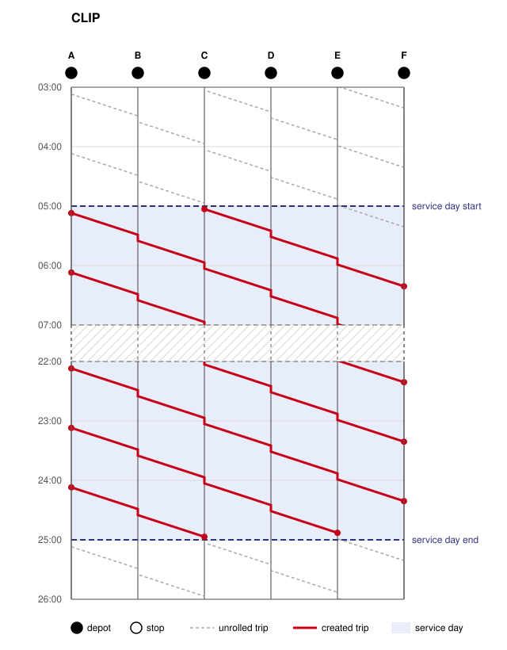
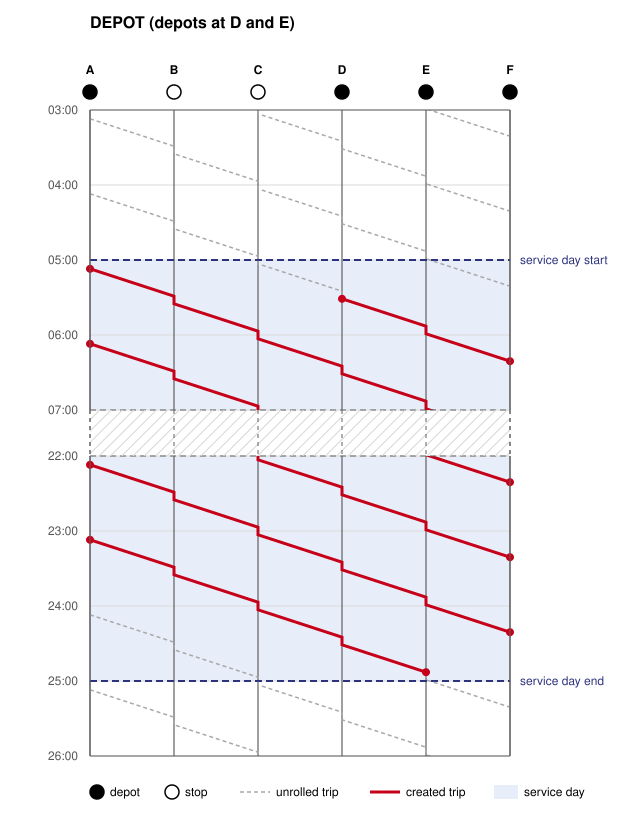
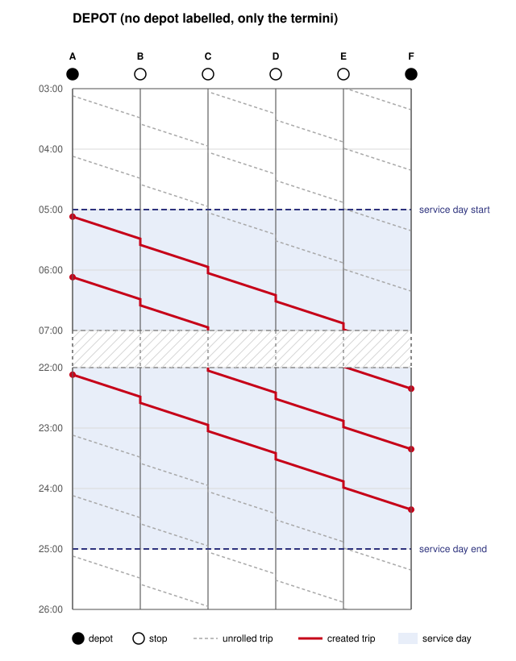

# Service Day Boundary

The network graphic describes one pattern hour. The converter rolls it out over the service day and decides with the
service day boundary which trips are created at the start and end of the service day.

## Model

The strategies are explained in two steps:

1. **Unroll:** Every line is rolled out infinitely. The trips repeat with the frequency of the trainrun, anchored at the
   times in the Netzgrafik-Editor, independent of the service day start.
2. **Cut:** With `CLIP` and `DEPOT`, each unrolled trip is cut once at its depots:
    - It starts at the first depot **departing at or after** the service day start.
    - It ends at the last depot **arriving at or before** the service day end.
    - If less than two stops remain, the trip is dropped.

| Strategy         | Trips                                                                  |
|------------------|------------------------------------------------------------------------|
| `FULL` (default) | Not cut, see below.                                                    |
| `CLIP`           | Cut at every stop.                                                     |
| `DEPOT`          | Cut at the stops with the depot label, and at the termini of the line. |

`FULL` keeps the behavior of earlier versions: A trip is created with its full route if it departs from its first stop
at or after the service day start and before its end, even if it arrives after the end. So `FULL` is not the same as
`DEPOT` with only the termini as depots, which additionally requires the arrival at the last stop before the end.

A stop that a line passes without stopping is never a depot for this line, even if it is labelled as depot: A trip
starting or ending there would let passengers board or alight where the timetable has no stop, and a transit route
always starts and ends with a stop.

### Guarantees

- Each unrolled trip results in at most one trip, so there are no duplicate trips, regardless of how many depots follow
  each other on a line.
- A cut trip keeps the times of the unrolled trip; at a cut end, the dwell time of the category applies, as at the
  termini. It is served as its own transit route (`<route>_<from stop>_<to stop>_<from index>_<to index>`).
- Trainruns with day time intervals (e.g. peak hours) are not cut; they run their full route within their intervals.

## Examples

The time-distance diagrams show a line A - F with hourly trips departing from A at minute 07, the same running time of
22 minutes on every section and a dwell time of 6 minutes at the intermediate stops. The service day is the default one
from 05:00 to 01:00 on the next day (25:00). The stops are vertical lines, with filled circles for depots and empty
circles for stops. The time runs downwards, so a trip runs down vertically while it stands at a stop. The diagrams show
the morning and the evening; during the day, no trip is cut.

The diagrams are generated with [diagrams.py](diagrams.py); run `python3 docs/service-day-boundary/diagrams.py` after
changing it.

### FULL

The trips departing from A from 05:07 to 24:07 run their full route; the trip departing at 24:07 arrives in F only at
26:21. The trips already running at 05:00 are not created.

### CLIP

Every stop is a depot. The trip departing from A at 04:07 stands in C across the service day start (04:57 to 05:03), so
it starts with its departure in C at 05:03. The trip departing at 03:07 departs from its last intermediate stop E at
04:59 and is dropped. In the evening, the trip departing at 23:07 ends at E (24:53). The trip departing at 24:07 stands
in C across the service day end (24:57 to 25:03), so it ends with its arrival in C at 24:57.

### DEPOT

With depots at D and E, B and C are no cut points anymore: The trip departing at 04:07 starts at D (05:31) instead of
C, and the trip departing at 24:07 is dropped, as it reaches no depot apart from A before 25:00. The trip departing at
23:07 ends at E (24:53), as with `CLIP`. The two depots next to each other still result in at most one trip per
unrolled trip.

### DEPOT without depot labels

Without labelled depots, only the termini A and F are depots. A trip is therefore only created if it departs from A at
or after 05:00 and arrives in F at or before 25:00, i.e. if it runs completely within the service day; there is no stop
in between where a trip running at the service day start or end could be cut. So the trips run from the one departing
at 05:07 to the one departing at 22:07, which arrives in F at 24:21. Compared to `FULL`, the trips departing at 23:07
and 24:07 are missing, as they arrive after 25:00.

## Lines Without Depot

With `DEPOT`, every line should stop at least once at a node with the depot label; a labelled terminus is sufficient.
Otherwise, its trips only start and end at the termini, as shown above. The validation strategy decides how this is
reported:

| Validation strategy                                                 | Line without depot                                |
|---------------------------------------------------------------------|---------------------------------------------------|
| `SKIP_VALIDATION`                                                   | Falls back to the termini.                        |
| `WARN_ON_ISSUES`, `REPLACE_WHITESPACE`, `REMOVE_SPECIAL_CHARACTERS` | Falls back to the termini and logs a warning.     |
| `FAIL_ON_ISSUES`                                                    | Fails the conversion, listing all affected lines. |

Missing depots cannot be repaired, so the repairing strategies only warn about them.
